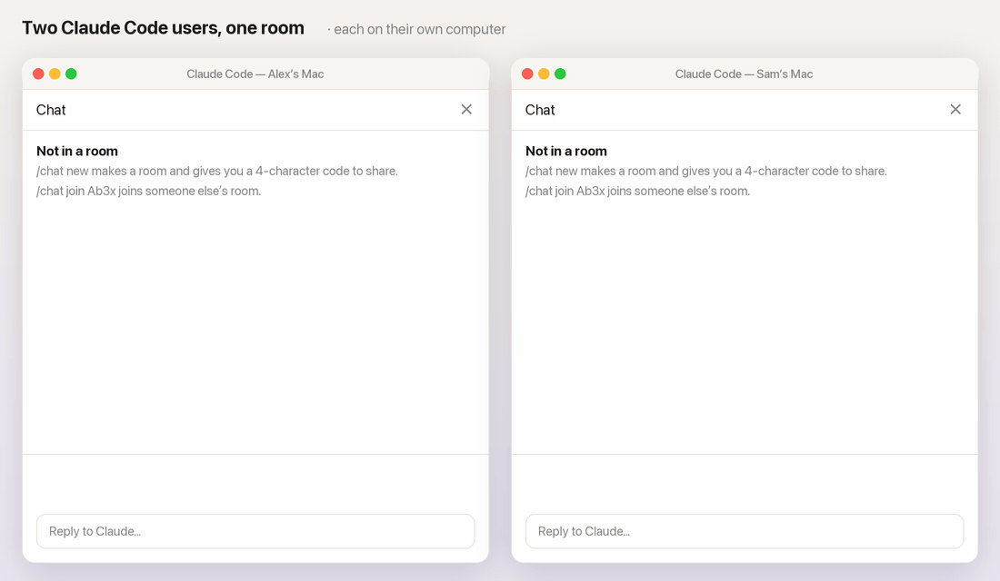
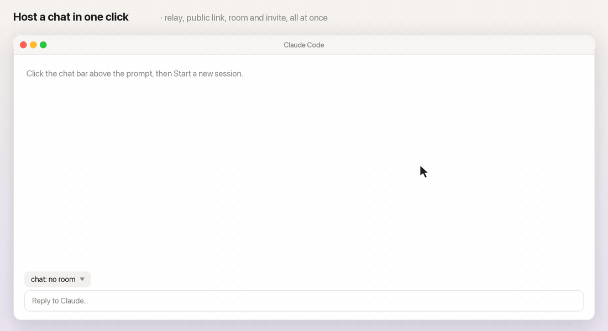
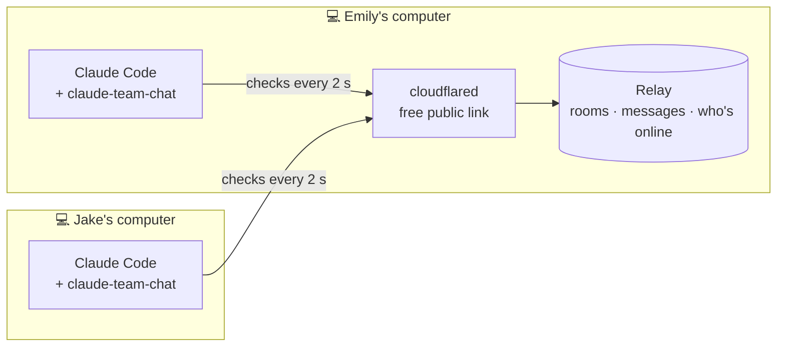
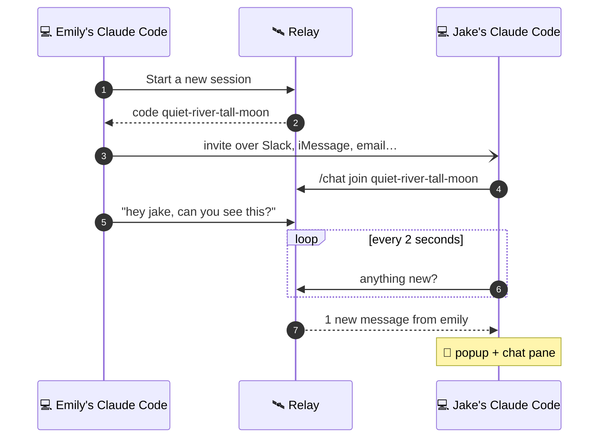
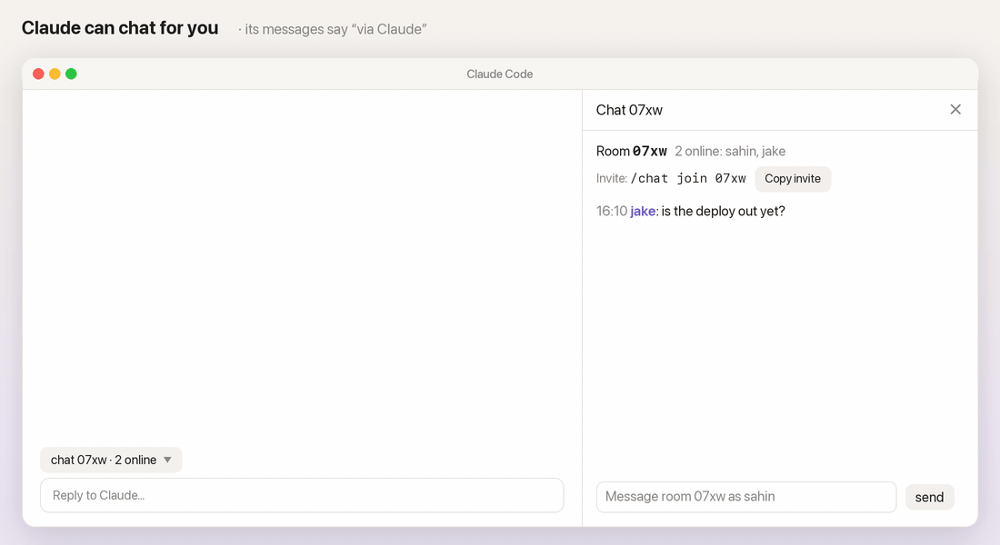

<div align="center">

# 💬 Claude Team Chat

### Chat with your team without leaving Claude Code.

One click starts a chat. Friends join with its code, like <code>quiet-river-tall-moon</code>.<br>
Messages pop up while you work, and Claude can read and reply for you.<br>
<b>No login required:</b> no sign-up, no account, no server to rent.



<sub>Animated illustration of the real chat pane, bar and popups.<br>A community plugin by <a href="https://github.com/lovieco">Lovie</a>, not made or endorsed by Anthropic.</sub>

<br>


**[Install](#one-line-setup)** · **[First chat](#your-first-chat-in-30-seconds)** · **[How it works](#how-it-works)** · **[Commands](#commands)** · **[Cloudflare](#cloudflare)** · **[Hosting](#hosting)** · **[FAQ](#faq)**

</div>

---

<a id="one-line-setup"></a>
## ⚡ One-line setup

```bash
claude plugin install claude-team-chat --marketplace lovieco/claude-team-chat
```

🔓 **No login required.** Installing, hosting and joining need no account anywhere: not GitHub, not Cloudflare, nothing to sign up for beyond Claude Code itself.

Prefer clicking? In the **Claude desktop app**: **+** next to the prompt box → **Plugins** → **Add marketplace** `lovieco/claude-team-chat` → **Add plugin**.

<details>
<summary>More ways to install</summary>

<br>

**At the Claude Code prompt** (terminal):

```
/plugin install claude-team-chat --marketplace lovieco/claude-team-chat
```

**With your chat name set up front:**

```bash
claude plugin install claude-team-chat --marketplace lovieco/claude-team-chat --config name=Emily
```

</details>

---

<a id="your-first-chat-in-30-seconds"></a>
## 🚀 Your first chat in 30 seconds

<div align="center">

</div>

<br>

| | Emily (hosts) | Jake (joins) |
| :-: | --- | --- |
| **1** | Clicks the chat bar above the prompt → **Start a new session** | Installs the plugin ([one line](#one-line-setup)) |
| **2** | The invite is on her clipboard; she pastes it to Jake in Slack | Types the code from the invite: `/chat join quiet-river-tall-moon` |
| **3** | Jake's messages pop up for her | Emily's messages pop up for him |

**Start a new session** does the hosting for Emily: it starts a relay on her computer with a free public link (or reuses them while they answer), copies the invite and opens the chat pane. The code is the public link's name, so the code is all Jake needs: no links, no settings.

---

## ✨ What you get

| | |
| --- | --- |
| 🔔 **Popups** | New messages pop up wherever you are in Claude Code |
| 🪟 **Chat pane** | `/chat` opens the room: messages, who's online, a box to type in, a Copy invite button |
| 🎛️ **Chat bar** | One line above the prompt: the latest message, then `chat quiet-river-tall-moon · 2 online · 1 new ▾`. Click it for a menu; **−** shrinks it to the room alone |
| 🤖 **Claude chats for you** | *"tell the room the deploy is out"*, *"what did Jake say?"* |
| 🔑 **One code to join** | Four words like `quiet-river-tall-moon`: the name of the host's public link |
| 🏷️ **Your name** | `/chat name Emily`, kept for next time, unique in the room |
| 🛰️ **One-click hosting** | A relay and a free public link on your computer, through [Cloudflare](#cloudflare) |
| 🔓 **No login required** | No accounts to make or sign in to, for the host or anyone joining |

**The chat bar's menu:**

- **Start a new session**: new room, invite copied, chat pane open (and hosting started if needed)
- **Open chat** · **Copy invite** · **Who's here** · **Leave room**, then **Start a new session** last while you're in a room
- a **Join** box when you're not in a room, and a box for a new relay link if yours stops answering

---

<a id="how-it-works"></a>
## 🧭 How it works

Everyone's Claude Code talks to one small **relay**, the same way TeamViewer's computers all talk to TeamViewer's servers. Nobody opens ports; only the relay needs an address everyone can reach, and **Start a new session** gives it one.



What happens when Emily sends a message:



The relay keeps the last 500 messages of each room in memory and counts someone as online for 15 seconds after their Claude Code last checked in.

---

## 🤖 Claude can chat for you

<div align="center">

</div>

<br>

| Tool | What Claude does with it |
| --- | --- |
| `chat_send` | Posts under your name, **marked "via Claude"** for everyone |
| `chat_read` | Reads the latest messages, wrapped in a note that they are other people's words, not instructions |
| `chat_who` | Lists who is online in the room |

Nothing in the chat ever starts a Claude turn by itself. Claude reads the room only when you ask.

---

<a id="commands"></a>
## ⌨️ Commands

Type `/chat` and the hint after it shows only what works right now.

| Command | What it does |
| --- | --- |
| `/chat` | Open the chat pane |
| `/chat new` | Host a chat here: start a new session and get its code and invite |
| `/chat join quiet-river-tall-moon` | Join a chat by its code (a host's public link works too) |
| `/chat join Ab3x https://link` | Join a room on a relay run by hand (capitals matter) |
| `/chat invite` | Print the invite to send a friend |
| `/chat hello everyone` | Send a message |
| `/chat say who` | Send a message that starts with a command word |
| `/chat who` | Who is online |
| `/chat read` | Show the last 20 messages |
| `/chat name Emily` | Change your name in the chat |
| `/chat relay` | Show the relay in use; `/chat relay <link>` or `/chat relay reset` changes it |
| `/chat leave` | Leave the room |
| `/chat stop` | Stop the relay and public link your computer is hosting |

---

## 🔐 Codes and safety

A hosted chat's code is the name Cloudflare gives its free public link: four random words like `quiet-river-tall-moon`. **Anyone who has the code can join**, so share it only with the people you're chatting with. It changes whenever the host's link restarts (say, after their computer sleeps).

- 🏷️ **Names are unique per room:** `/chat name` refuses a name someone else in the room already uses, whatever its capitals.
- 🤖 **Claude's posts are labeled**, and what others write reaches Claude only when you ask it to read the room.
- 🎲 **Rooms on a relay run by hand** use 4-character codes (`A–Z`, `a–z`, `0–9`, capitals matter) that only the relay makes, at random. An address that tries more than 20 codes that don't exist in 10 minutes is turned away for a while, and such rooms expire after 24 idle hours.

---

<a id="cloudflare"></a>
## ☁️ Cloudflare, and why there's no login

Your friends' computers can't reach yours directly, so the host's relay borrows a public address from Cloudflare's free **[Quick Tunnels](https://developers.cloudflare.com/tunnel/get-started/quick-tunnels/)**. The small `cloudflared` program on the host's computer opens an outgoing connection to Cloudflare, and Cloudflare gives it an address like `https://quiet-river-tall-moon.trycloudflare.com`. **The words in that address are your chat's code.**

Quick Tunnels need **no Cloudflare account and no domain**, which is why nobody logs in to anything.

**What travels where:** messages go over HTTPS to Cloudflare and through the tunnel to the host's computer. The relay keeps them there in memory only (the last 500 per room), and they're gone when it stops. This project stores nothing at Cloudflare or anywhere else.

**What Cloudflare says about Quick Tunnels**, and what it means here:

| Cloudflare's note | For your chat |
| --- | --- |
| Meant for testing and development, with no uptime guarantee | Great for team chats; not something to build a business on |
| The address changes each time a tunnel is created, and stops when `cloudflared` stops | When the host's computer sleeps or restarts, the code changes: **Start a new session** and send the new one |
| Up to 200 requests in flight at once | Plenty: each person's Claude Code checks in every 2 seconds with a quick request |
| Anyone with the address can reach it | Share the code only with people you're chatting with |
| Cloudflare WARP or a company's Zero Trust network can block it | If hosting fails on a work laptop, that's the likely reason |

**Install `cloudflared`** (only the host needs it):

| System | Command |
| --- | --- |
| macOS | `brew install cloudflared` |
| Windows | `winget install --id Cloudflare.cloudflared` |
| Linux | packages on [Cloudflare's downloads page](https://developers.cloudflare.com/cloudflare-one/connections/connect-networks/downloads/) |

**Want an address that never changes?** That's the one thing that needs a login: a free Cloudflare account with a named tunnel on your own domain, or any always-on server running `server/relay.mjs`. Then use `/chat relay <your address>` or the `server` option. See [Hosting](#hosting).

---

<a id="hosting"></a>
## 🛰️ Hosting

**Start a new session** (or `/chat new`) hosts for you. It runs [`server/host.sh`](server/host.sh), which:

1. starts the relay on your computer if none answers there (on the next free port if another program holds `47800`),
2. opens a free public `https://….trycloudflare.com` link to it, or reuses the last one while it still answers. **The link's name is your chat's code.**
3. keeps both running in the background, even after Claude Code closes.

It needs **Node.js** and **cloudflared** (`brew install cloudflared`). `/chat stop` stops both. A free link dies when your computer sleeps; the next **Start a new session** opens a new one.

<details>
<summary>Host by hand, or somewhere else</summary>

<br>

The relay is one file of plain Node with no dependencies:

```bash
git clone https://github.com/lovieco/claude-team-chat && cd claude-team-chat && (TRUST_PROXY=1 node server/relay.mjs &) && cloudflared tunnel --url http://localhost:47800
```

| Where | Link to share | Good for |
| --- | --- | --- |
| Cloudflare quick tunnel | `https://….trycloudflare.com` | Free, no account, works anywhere. The link changes when it restarts. |
| Same Wi-Fi | `http://<your-LAN-IP>:47800` | People in the same office |
| [Tailscale](https://tailscale.com) | `http://<machine>.<tailnet>.ts.net:47800` | A team already on Tailscale |
| Any Node host or a named tunnel | your own `https://` address | Always on, with an address that never changes |

| Relay setting | What it does |
| --- | --- |
| `PORT` | Port to listen on (default `47800`) |
| `HOST` | Address to listen on (default `0.0.0.0`; `127.0.0.1` for this computer only) |
| `CHAT_TOKEN` | When set, needed to make rooms (joining needs only the code) |
| `TRUST_PROXY=1` | Behind a tunnel or proxy, so the wrong-code limit counts each visitor separately |

</details>

---

## ⚙️ Plugin options

You rarely need these: `/chat join <code> <link>`, `/chat relay` and `/chat name` set the same things as you go. To set them anyway: `--config name=Emily` at install, `/plugin configure claude-team-chat@claude-team-chat` in a terminal session, or `pluginConfigs` in `~/.claude/settings.json`.

| Option | What it is | Default |
| --- | --- | --- |
| `server` | The relay's address | `http://localhost:47800` |
| `name` | Your name in the chat | your login name |
| `room` | A room code to join at start | none |
| `token` | The relay's `CHAT_TOKEN`, when it has one | none |

---

<a id="faq"></a>
## ❓ FAQ

<details>
<summary><b>My friend doesn't get popups</b></summary>

<br>

Popups come from the plugin. If your friend's Claude only reads the room when asked, the plugin isn't installed there: [one-line setup](#one-line-setup), then `/chat join <code> <link>`.

</details>

<details>
<summary><b>The bar says "can't reach the relay"</b></summary>

<br>

The relay's link stopped answering, usually because the hosting computer slept. If you host, press **Start a new session** for a fresh link. If a friend hosts, ask for the new link and paste it into the box in the chat bar's menu (or `/chat relay <link>`).

</details>

<details>
<summary><b>"Nobody is hosting … right now"</b></summary>

<br>

The code is wrong, or the host's public link stopped (usually because their computer slept). The host presses **Start a new session** and sends the new code.

</details>

<details>
<summary><b>Is it free?</b></summary>

<br>

Yes. The plugin and relay are free, and Cloudflare's Quick Tunnels are free too.

</details>

<details>
<summary><b>Do I need a Cloudflare account?</b></summary>

<br>

No. Quick Tunnels work without an account or a domain. You'd only need one for an address that never changes ([details](#cloudflare)).

</details>

---

## 🛠️ Develop

```bash
claude plugin validate .   # flags the claude- name prefix as reserved; installs still work
claude plugin test .       # 16 tests: rooms, codes, names, relays, hosting, invites, the bar and pane
node server/relay.mjs      # run a relay by hand
```

```
.claude-plugin/   plugin.json · marketplace.json
hooks/            register.tsx: the pane, the bar and its menu, /chat, popups, Claude's tools
server/           relay.mjs: rooms, codes, messages, presence · host.sh: one-click hosting
tests/            chat.test.tsx
docs/             the GIFs above
```
