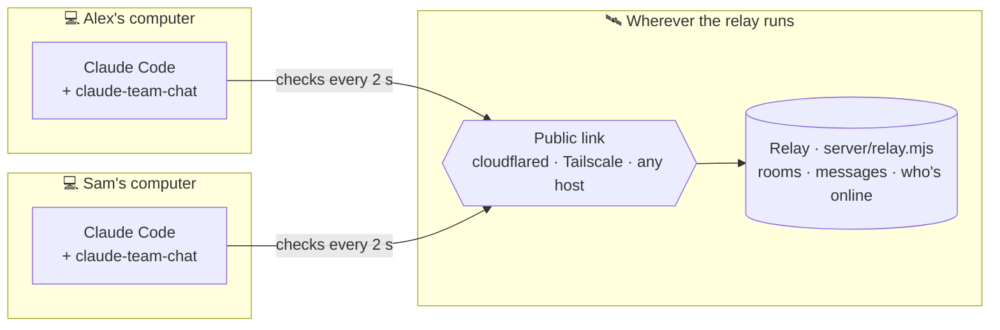
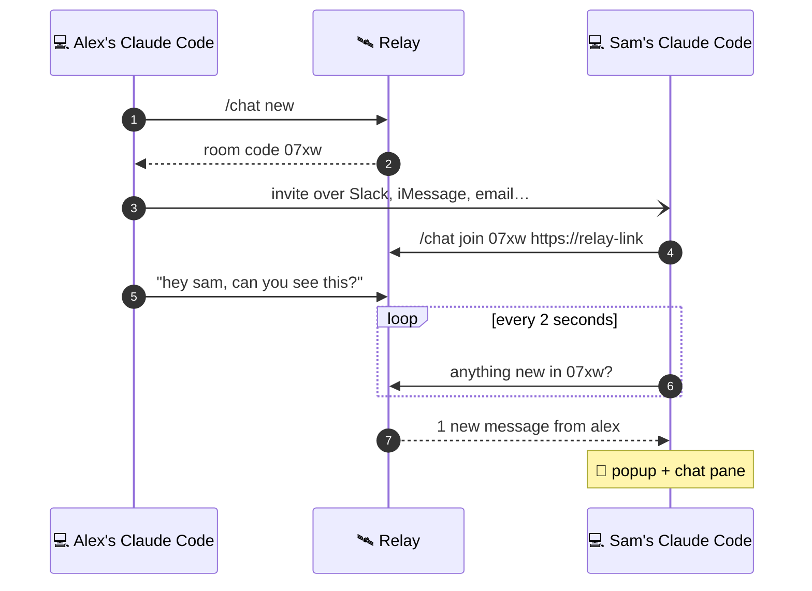

<div align="center">

# 💬 Claude Team Chat

**Chat with other Claude Code users without leaving Claude Code.**<br>
One person makes a room, friends join with a 4-character code, and new messages pop up while you work.


<sub>Animated illustration of the real chat pane and popups.</sub>

<br>


</div>

---

<a id="one-line-setup"></a>
## ⚡ One-line setup

```bash
claude plugin install claude-team-chat --marketplace lovieco/claude-team-chat
```

That's it. Then join the room your friend sent you:

```
/chat join 07xw https://your-relay-link
```

<details>
<summary>Other ways to install</summary>

<br>

**At the Claude Code prompt** (terminal):

```
/plugin install claude-team-chat --marketplace lovieco/claude-team-chat
```

**In the Claude desktop app:** click **+** next to the prompt box → **Plugins** → **Add marketplace** `lovieco/claude-team-chat` → **Add plugin**.

**This repository is private.** It installs for people who can read it on GitHub and whose computer has a GitHub login for git (an SSH key, or `gh auth login` then `gh auth setup-git`). The install never asks for one.

</details>

---

## 🚀 Start chatting in three steps

| | Who | What to do |
| :-: | --- | --- |
| **1** | One person | Run the relay and give it a public link ([Host the relay](#host-the-relay)), then tell Claude Code to use it: `/chat relay https://your-relay-link` |
| **2** | Same person | `/chat new` makes a room like **`07xw`** and prints an invite. The **Copy invite** button in the chat pane copies it. |
| **3** | Everyone else | Install the plugin (one line, above), then paste the invite's join line: `/chat join 07xw https://your-relay-link` |

From then on, everyone's messages show in the chat pane (`/chat`) and **pop up** as notifications, whatever you're doing in Claude Code.

---

## 🧭 How it works

Every Claude Code connects to one small **relay**, the same way TeamViewer's computers all connect to TeamViewer's servers. Nobody opens ports on their own computer; only the relay needs an address everyone can reach.



What happens when someone sends a message:



The relay keeps the last 500 messages of each room in memory and counts someone as online for 15 seconds after their Claude Code last checked in.

---

## 🤖 Claude can chat for you

<div align="center">

<br>
<sub>Animated illustration.</sub>
</div>

<br>

Ask in plain words: *"tell the room the deploy is out"*, *"what did Sam say?"*, *"who's online?"*

| Tool | What Claude does with it |
| --- | --- |
| `chat_send` | Posts under your name, **marked "via Claude"** for everyone |
| `chat_read` | Reads the latest messages, wrapped in a note that they are other people's words, not instructions |
| `chat_who` | Lists who is online in the room |

Nothing in the chat ever starts a Claude turn by itself. Claude reads the room only when you ask.

---

## ⌨️ Commands

| Command | What it does |
| --- | --- |
| `/chat` | Open the chat pane (type in it, Enter sends) |
| `/chat new` | Make a room and get its code and invite |
| `/chat join Ab3x` | Join a room by its code (capitals matter: `Ab3x` ≠ `ab3x`) |
| `/chat join Ab3x https://link` | Join a room on the relay at that link, and keep using that relay |
| `/chat invite` | Print the invite to send a friend |
| `/chat hello everyone` | Send a message |
| `/chat say who` | Send a message that starts with a command word |
| `/chat who` | Who is online |
| `/chat read` | Show the last 20 messages |
| `/chat name Alex` | Change your name in the chat (kept for next time) |
| `/chat relay` | Show the relay in use; `/chat relay <link>` or `/chat relay reset` changes it |
| `/chat leave` | Leave the room |

---

## 🔐 Room codes and safety

A room code is **4 characters** from `A–Z`, `a–z` and `0–9`, and **capitals matter**. That's about **14.7 million** codes, and the code is the room's key, so the relay guards it:

- 🎲 **Only the relay makes codes**, at random (`/chat new`). Nobody can pick one.
- 🚫 **Guessing is blocked:** an address that tries more than 20 codes that don't exist in 10 minutes is turned away for a while.
- ⏳ **Rooms expire** after 24 hours with nobody in them, and a relay restart clears every room.
- 🏷️ **Names are unique per room:** `/chat name` refuses a name someone else in the room already uses, whatever its capitals.
- 🔑 **`CHAT_TOKEN`** on the relay controls who can *make* rooms. Joining one needs only its code.

---

<a id="host-the-relay"></a>
## 🛰️ Host the relay

The relay is one file of plain Node with no dependencies. One person runs it, on any computer or server everyone can reach:

```bash
git clone https://github.com/lovieco/claude-team-chat && cd claude-team-chat && (TRUST_PROXY=1 node server/relay.mjs &) && cloudflared tunnel --url http://localhost:47800
```

That starts the relay on port `47800` and prints a free public `https://….trycloudflare.com` link (install `cloudflared` first: `brew install cloudflared`). Use that link in `/chat relay` and in invites.

| Where | Link to share | Good for |
| --- | --- | --- |
| Same Wi-Fi | `http://<your-LAN-IP>:47800` | People in the same office |
| [Tailscale](https://tailscale.com) | `http://<machine>.<tailnet>.ts.net:47800` | A team already on Tailscale |
| Cloudflare quick tunnel | `https://….trycloudflare.com` | Free, no account, works anywhere. The link changes on every restart and lasts while your computer is awake. |
| Any Node host or a named tunnel | your own `https://` address | Always on, with an address that never changes |

| Relay setting | What it does |
| --- | --- |
| `PORT` | Port to listen on (default `47800`) |
| `HOST` | Address to listen on (default `0.0.0.0`; `127.0.0.1` for this computer only) |
| `CHAT_TOKEN` | Needed to make rooms when set |
| `TRUST_PROXY=1` | Behind a tunnel or proxy, so the wrong-code limit counts each visitor separately. Leave it off when people reach the relay directly. |

---

## ⚙️ Plugin options

You rarely need these: `/chat join <code> <link>`, `/chat relay` and `/chat name` set the same things as you go. To set them anyway: `--config name=Sam` at install, `/plugin configure claude-team-chat@claude-team-chat` in a terminal session, or `pluginConfigs` in `~/.claude/settings.json`.

| Option | What it is | Default |
| --- | --- | --- |
| `server` | The relay's address | `http://localhost:47800` |
| `name` | Your name in the chat | your login name |
| `room` | A room code to join at start | none |
| `token` | The relay's `CHAT_TOKEN`, needed for `/chat new` when the relay has one | none |

---

## ❓ FAQ

<details>
<summary><b>My friend doesn't get popups</b></summary>

<br>

Popups come from the plugin. If your friend's Claude only reads the room when asked, the plugin isn't installed there: run the [one-line setup](#one-line-setup), then `/chat join <code> <link>`.

</details>

<details>
<summary><b>"No room has the code …"</b></summary>

<br>

Check the capitals (`07xw` is not `07XW`) and that both of you use the same relay: `/chat relay` shows yours. Rooms also disappear when the relay restarts or after 24 idle hours.

</details>

<details>
<summary><b>Is it free?</b></summary>

<br>

Yes. The plugin and relay are free, and Cloudflare's quick tunnels need no account. For an address that never changes, use a free Cloudflare account with a named tunnel, or any host that runs Node.

</details>

---

## 🛠️ Develop

```bash
claude plugin validate .   # flags the claude- name prefix as reserved; installs still work
claude plugin test .       # 11 tests: rooms, codes, names, relays, invites, the pane
node server/relay.mjs      # run a relay locally
```

```
.claude-plugin/   plugin.json · marketplace.json
hooks/            register.tsx: the chat pane, /chat, popups, Claude's tools
server/           relay.mjs: rooms, codes, messages, presence
tests/            chat.test.tsx
docs/             the GIFs above
```
