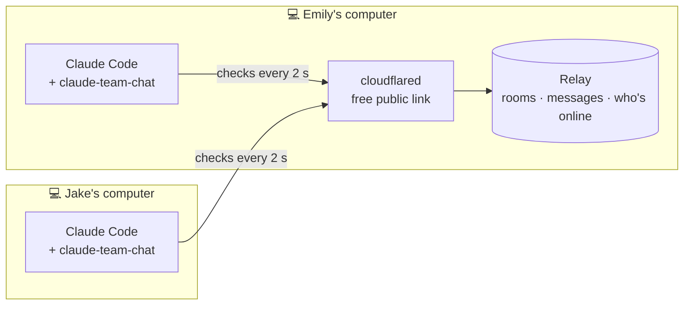
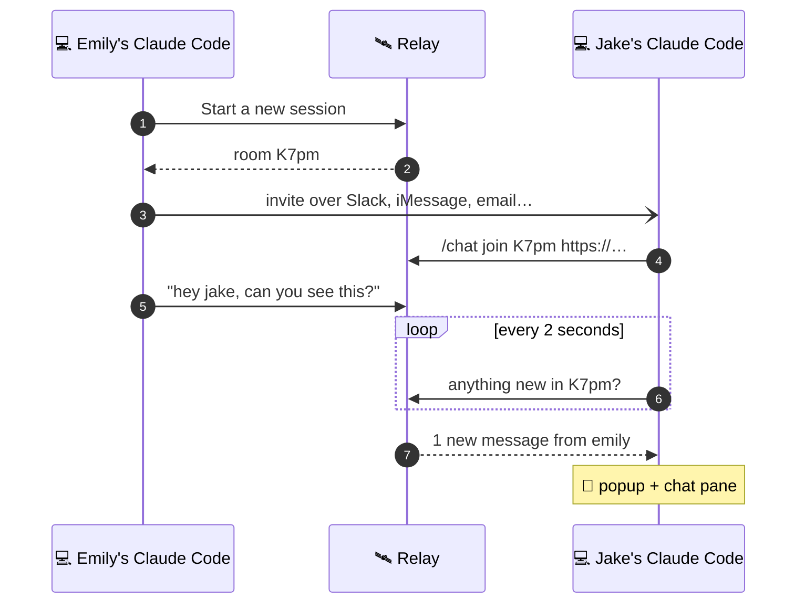

<div align="center">

# 💬 Claude Team Chat

### Chat with your team without leaving Claude Code.

One click starts a room. Friends join with a 4-character code.<br>
Messages pop up while you work, and Claude can read and reply for you.


<sub>Animated illustration of the real chat pane, bar and popups.</sub>

<br>


**[Install](#one-line-setup)** · **[First chat](#your-first-chat-in-30-seconds)** · **[How it works](#how-it-works)** · **[Commands](#commands)** · **[Hosting](#hosting)** · **[FAQ](#faq)**

</div>

---

<a id="one-line-setup"></a>
## ⚡ One-line setup

```bash
claude plugin install claude-team-chat --marketplace lovieco/claude-team-chat
```

Prefer clicking? In the **Claude desktop app**: **+** next to the prompt box → **Plugins** → **Add marketplace** `lovieco/claude-team-chat` → **Add plugin**.

<details>
<summary>More ways to install</summary>

<br>

**At the Claude Code prompt** (terminal):

```
/plugin install claude-team-chat --marketplace lovieco/claude-team-chat
```

**With your chat name set up front:**

```bash
claude plugin install claude-team-chat --marketplace lovieco/claude-team-chat --config name=Emily
```

**This repository is private.** It installs for people who can read it on GitHub and whose computer has a GitHub login for git (an SSH key, or `gh auth login` then `gh auth setup-git`). The install never asks for one.

</details>

---

<a id="your-first-chat-in-30-seconds"></a>
## 🚀 Your first chat in 30 seconds

<div align="center">

</div>

<br>

| | Emily (hosts) | Jake (joins) |
| :-: | --- | --- |
| **1** | Clicks the chat bar above the prompt → **Start a new session** | Installs the plugin ([one line](#one-line-setup)) |
| **2** | The invite is on her clipboard; she pastes it to Jake in Slack | Pastes the join line from the invite: `/chat join K7pm https://…` |
| **3** | Jake's messages pop up for her | Emily's messages pop up for him |

**Start a new session** does the hosting for Emily: if no relay answers, it starts one on her computer with a free public link, makes a room, copies the invite and opens the chat pane. Jake pastes the link only once; after that his Claude Code remembers the relay.

---

## ✨ What you get

| | |
| --- | --- |
| 🔔 **Popups** | New messages pop up wherever you are in Claude Code |
| 🪟 **Chat pane** | `/chat` opens the room: messages, who's online, a box to type in, a Copy invite button |
| 🎛️ **Chat bar** | Above the prompt: `chat 07xw · 2 online · 1 new ▾`. Click it for a menu |
| 🤖 **Claude chats for you** | *"tell the room the deploy is out"*, *"what did Jake say?"* |
| 🔑 **Rooms by code** | 4 characters, capitals matter (`K7pm` ≠ `k7pm`) |
| 🏷️ **Your name** | `/chat name Emily`, kept for next time, unique in the room |
| 🛰️ **One-click hosting** | A relay and a free public link on your computer, nothing to sign up for |

**The chat bar's menu:**

- **Start a new session**: new room, invite copied, chat pane open (and hosting started if needed)
- **Open chat** · **Copy invite** · **Who's here** · **Leave room**
- a **Join** box when you're not in a room, and a box for a new relay link if yours stops answering

---

<a id="how-it-works"></a>
## 🧭 How it works

Everyone's Claude Code talks to one small **relay**, the same way TeamViewer's computers all talk to TeamViewer's servers. Nobody opens ports; only the relay needs an address everyone can reach, and **Start a new session** gives it one.



What happens when Emily sends a message:



The relay keeps the last 500 messages of each room in memory and counts someone as online for 15 seconds after their Claude Code last checked in.

---

## 🤖 Claude can chat for you

<div align="center">

</div>

<br>

| Tool | What Claude does with it |
| --- | --- |
| `chat_send` | Posts under your name, **marked "via Claude"** for everyone |
| `chat_read` | Reads the latest messages, wrapped in a note that they are other people's words, not instructions |
| `chat_who` | Lists who is online in the room |

Nothing in the chat ever starts a Claude turn by itself. Claude reads the room only when you ask.

---

<a id="commands"></a>
## ⌨️ Commands

Type `/chat` and the hint after it shows only what works right now.

| Command | What it does |
| --- | --- |
| `/chat` | Open the chat pane |
| `/chat new` | Start a new session: a room (hosting it here if needed) and its invite |
| `/chat join K7pm` | Join a room by its code, on the relay you use |
| `/chat join K7pm https://link` | Join a room on the relay at that link, and keep using that relay |
| `/chat invite` | Print the invite to send a friend |
| `/chat hello everyone` | Send a message |
| `/chat say who` | Send a message that starts with a command word |
| `/chat who` | Who is online |
| `/chat read` | Show the last 20 messages |
| `/chat name Emily` | Change your name in the chat |
| `/chat relay` | Show the relay in use; `/chat relay <link>` or `/chat relay reset` changes it |
| `/chat leave` | Leave the room |
| `/chat stop` | Stop the relay and public link your computer is hosting |

---

## 🔐 Room codes and safety

A room code is **4 characters** from `A–Z`, `a–z` and `0–9`, and **capitals matter**. That's about **14.7 million** codes, and the code is the room's key, so the relay guards it:

- 🎲 **Only the relay makes codes**, at random. Nobody can pick one.
- 🚫 **Guessing is blocked:** an address that tries more than 20 codes that don't exist in 10 minutes is turned away for a while.
- ⏳ **Rooms expire** after 24 hours with nobody in them, and a relay restart clears every room.
- 🏷️ **Names are unique per room:** `/chat name` refuses a name someone else in the room already uses, whatever its capitals.
- 🤖 **Claude's posts are labeled**, and what others write reaches Claude only when you ask it to read the room.

---

<a id="hosting"></a>
## 🛰️ Hosting

**Start a new session** (or `/chat new`) hosts for you. It runs [`server/host.sh`](server/host.sh), which:

1. starts the relay on your computer if none answers there,
2. opens a free public `https://….trycloudflare.com` link to it, or reuses the last one while it still answers,
3. keeps both running in the background, even after Claude Code closes.

It needs **Node.js** and **cloudflared** (`brew install cloudflared`). `/chat stop` stops both. A free link dies when your computer sleeps; the next **Start a new session** opens a new one.

<details>
<summary>Host by hand, or somewhere else</summary>

<br>

The relay is one file of plain Node with no dependencies:

```bash
git clone https://github.com/lovieco/claude-team-chat && cd claude-team-chat && (TRUST_PROXY=1 node server/relay.mjs &) && cloudflared tunnel --url http://localhost:47800
```

| Where | Link to share | Good for |
| --- | --- | --- |
| Cloudflare quick tunnel | `https://….trycloudflare.com` | Free, no account, works anywhere. The link changes when it restarts. |
| Same Wi-Fi | `http://<your-LAN-IP>:47800` | People in the same office |
| [Tailscale](https://tailscale.com) | `http://<machine>.<tailnet>.ts.net:47800` | A team already on Tailscale |
| Any Node host or a named tunnel | your own `https://` address | Always on, with an address that never changes |

| Relay setting | What it does |
| --- | --- |
| `PORT` | Port to listen on (default `47800`) |
| `HOST` | Address to listen on (default `0.0.0.0`; `127.0.0.1` for this computer only) |
| `CHAT_TOKEN` | When set, needed to make rooms (joining needs only the code) |
| `TRUST_PROXY=1` | Behind a tunnel or proxy, so the wrong-code limit counts each visitor separately |

</details>

---

## ⚙️ Plugin options

You rarely need these: `/chat join <code> <link>`, `/chat relay` and `/chat name` set the same things as you go. To set them anyway: `--config name=Emily` at install, `/plugin configure claude-team-chat@claude-team-chat` in a terminal session, or `pluginConfigs` in `~/.claude/settings.json`.

| Option | What it is | Default |
| --- | --- | --- |
| `server` | The relay's address | `http://localhost:47800` |
| `name` | Your name in the chat | your login name |
| `room` | A room code to join at start | none |
| `token` | The relay's `CHAT_TOKEN`, when it has one | none |

---

<a id="faq"></a>
## ❓ FAQ

<details>
<summary><b>My friend doesn't get popups</b></summary>

<br>

Popups come from the plugin. If your friend's Claude only reads the room when asked, the plugin isn't installed there: [one-line setup](#one-line-setup), then `/chat join <code> <link>`.

</details>

<details>
<summary><b>The bar says "can't reach the relay"</b></summary>

<br>

The relay's link stopped answering, usually because the hosting computer slept. If you host, press **Start a new session** for a fresh link. If a friend hosts, ask for the new link and paste it into the box in the chat bar's menu (or `/chat relay <link>`).

</details>

<details>
<summary><b>"No room has the code …"</b></summary>

<br>

Check the capitals (`07xw` is not `07XW`) and that you both use the same relay: `/chat relay` shows yours. Rooms also disappear when the relay restarts or after 24 idle hours.

</details>

<details>
<summary><b>Is it free?</b></summary>

<br>

Yes. The plugin and relay are free, and Cloudflare's quick tunnels need no account.

</details>

---

## 🛠️ Develop

```bash
claude plugin validate .   # flags the claude- name prefix as reserved; installs still work
claude plugin test .       # 16 tests: rooms, codes, names, relays, hosting, invites, the bar and pane
node server/relay.mjs      # run a relay by hand
```

```
.claude-plugin/   plugin.json · marketplace.json
hooks/            register.tsx: the pane, the bar and its menu, /chat, popups, Claude's tools
server/           relay.mjs: rooms, codes, messages, presence · host.sh: one-click hosting
tests/            chat.test.tsx
docs/             the GIFs above
```
